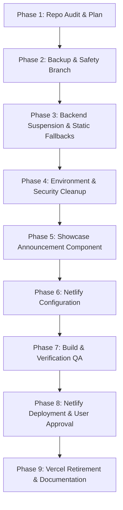

# CrossFire 2026 — Static Frontend Showcase Migration Plan
**Document Version:** 1.0.0  
**Target Environment:** Netlify (Static Hosting)  
**Previous Environment:** Vercel (`https://cross-fire-three.vercel.app`)  
**Branch:** `chore/netlify-static-migration`  
**Author Roles:** Principal Backend Engineer, DevOps Architect, Frontend Engineer, Security Auditor  

---

## 1. Executive Summary & Objectives
The goal of this migration is to transition the **CrossFire 2026** full-stack web application into a **premium static frontend showcase** hosted on Netlify, while safely suspending backend operations without deleting recoverable backend source code, database migrations, or production data. The existing Vercel deployment will be retired only after independent verification of the Netlify showcase.

### Key Objectives
1. **Safely suspend backend operations:** Disable client-side calls to Supabase Auth, Edge Functions, RPCs, and PostgreSQL tables during production static browsing.
2. **Preserve backend source code:** Retain all Edge Functions (`supabase/functions/`), database migrations (`supabase/migrations/`), schema files (`supabase/schema.sql`), and admin scripts (`scripts/`).
3. **Eliminate backend build blockers:** Decouple `vite.config.ts` and `scripts/build-security.mjs` from mandatory Supabase production URL / Anon Key injection during static builds.
4. **Environment & Security Hardening:** Audit environment variables, eliminate secret embedding into client assets, and document revocations.
5. **Polished Showcase Banner & Contextual Notifications:** Present an elegant announcement informing visitors that backend services are paused, with direct links to collaborate with True Inspires.
6. **Netlify Deployment Configuration:** Configure `netlify.toml` for Vite SPA static output (`dist`), routing fallbacks, and security headers.
7. **Zero-Downtime / Safe Vercel Retirement:** Verify Netlify deployment before initiating any DNS changes or Vercel project decommissioning.

---

## 2. Repository & Architecture Audit

### 2.1 Detected Tech Stack
- **Frontend Framework:** React 18.3.1 (TypeScript 5.7.3)
- **Bundler & Tooling:** Vite 6.1.0 (`vite build`), PostCSS, Tailwind CSS 3.4.17
- **Routing:** Hash-based SPA routing (`#landing`, `#events`, `#register`, `#leaderboard`, `#my-pass`, `#dashboard`, etc.)
- **Motion & Graphics:** Three.js / React Three Fiber / Drei, Framer Motion 14.3.0, GSAP 3.15.0, Lenis smooth scrolling
- **Backend Services (Suspended in Showcase):**
  - Supabase Database (PostgreSQL with RLS policies)
  - Supabase Auth (PKCE flow, session persistence, TOTP MFA for super_admin)
  - Supabase Edge Functions:
    - `register-student`: Student intake and pass ID generation
    - `participant-pass`: Public pass lookup by email and mobile
    - `student-portal`: Student authentication and password issuance
    - `invite-student`: Direct invitation dispatch via Resend
    - `provision-staff`: Staff member onboarding
  - Realtime & Polling hooks: `useNotifications`, `useLeaderboard`, `HomepageAnnouncements`

### 2.2 Backend-Dependent Features Inventory
| Component / Page | File | Backend Dependency | Showcase Mode Strategy |
| :--- | :--- | :--- | :--- |
| **Arena & Event Directory** | `src/context/EventsContext.tsx`, `src/pages/EventsDiscoveryPage.tsx` | `supabase.from('events').select('*')` | Populate directly from static `EVENT_CATALOG` (`src/data/eventCatalog.ts`). Preserves all 7 arenas, prizes (₹56,000), schedules, and rubrics with zero network latency. |
| **Student Registration** | `src/pages/RegistrationPage.tsx`, `src/lib/registrationRequests.ts` | `register-student` Edge function, `get_system_setting` RPC | Render an informative showcase notice explaining that registration intake is paused in showcase mode. Retain the Google Form emergency backup link and contact coordinates. |
| **Participant Pass Lookup** | `src/pages/MyPassPage.tsx`, `src/lib/participantPass.ts` | `participant-pass` Edge function | Render an explanatory banner noting that dynamic database pass lookups are paused in showcase mode. |
| **Authentication & Portals** | `src/context/AuthContext.tsx`, `src/components/AuthModal.tsx`, `src/pages/*Dashboard*.tsx` | `supabase.auth.*`, `crossfire_current_profile` RPC | Display clear, non-blocking modal notice stating that staff/student logins and operational desks are inactive in showcase mode. |
| **Leaderboard & Awards** | `src/pages/LeaderboardPage.tsx`, `src/hooks/useLeaderboard.ts`, `src/operations/ResultsDesk.tsx` | `get_leaderboard` RPC, `published_event_awards` RPC | Gracefully show the polished awaiting/showcase state with zero console errors or broken network requests. |
| **Live Announcements** | `src/components/HomepageAnnouncements.tsx` | `supabase.from('crossfire_homepage_announcements')` | Deactivate background interval querying when operating in showcase mode. |
| **Notifications Dropdown** | `src/hooks/useNotifications.ts`, `src/components/Navbar.tsx` | `supabase.from('notifications')` | Silence background polling when backend is paused; return empty state cleanly. |
| **Live Notice Dialog** | `src/components/RegistrationLiveNotice.tsx`, `src/hooks/useRegistrationNotice.ts` | Auth and registration status checks | Suppress intrusive live popups in showcase mode. |

---

## 3. Step-by-Step Migration Phases

### Phase 2: Backup and Safety
- Active branch: `chore/netlify-static-migration`.
- Preserve all existing files in version control.
- Ensure `.env*` files and test logs (`.codex-local/`) are strictly git-ignored.
- No deletions of database tables, edge functions, or cloud resources.

### Phase 3: Backend Suspension
- Update `src/lib/supabase.ts` to recognize static showcase mode (`VITE_SHOWCASE_MODE=true` or absent credentials), returning an inactive client without throwing runtime exceptions.
- Provide `EventsContext` with immediate static hydration from `EVENT_CATALOG` so all event data, rules, fees, and prizes display instantaneously.
- Halt polling intervals across `AuthContext`, `EventsContext`, `useNotifications`, `useLeaderboard`, and `HomepageAnnouncements`.
- Update `RegistrationPage` and `MyPassPage` to display contextual, friendly showcase status notices.

### Phase 4: Environment and Security Cleanup
- Audit environment variable names:
  - Obsolete in client static build: `VITE_SUPABASE_URL`, `VITE_SUPABASE_ANON_KEY`, `VITE_EMAIL_AUTH_READY`, `VITE_STUDENT_SIGNIN_PUBLIC`.
  - Server-only secrets to remain untouched in remote vaults: `DIRECT_URL`, `SUPABASE_SERVICE_ROLE_KEY`, `CROSSFIRE_ISSUANCE_SECRET`, `CROSSFIRE_RESEND_API_KEY`.
- Update `scripts/build-security.mjs` and `vite.config.ts` so static builds succeed without requiring remote Supabase credentials.
- Provide a clean `.env.example` documenting non-secret parameters.

### Phase 5: Premium Showcase Announcement
- Build a responsive, accessible Announcement component:
  - **Primary Text:** "This website is currently operating in showcase mode. Our backend services are temporarily paused, but you can still explore the design and experience."
  - **Secondary Text:** "Want a premium website like this for your brand or business? Let's build something exceptional together."
  - **CTA 1:** `Start a Project` (`mailto:info.trueinspire.ac@gmail.com`)
  - **CTA 2:** `Explore True Inspires` (`https://true-inspires.vercel.app/`)
- Display as a dismissible top banner and in contextual locations without intrusive dialog blocking.
- Honor `prefers-reduced-motion`.

### Phase 6: Netlify Deployment Configuration
- Create `netlify.toml` with:
  - Base: repository root (`CrossFire` or build settings)
  - Build command: `npm run build`
  - Publish directory: `dist`
  - SPA rewrite: `/* -> /index.html 200`
  - Hardened security headers (CSP without external API connection, X-Frame-Options, X-Content-Type-Options, etc.)
- Keep `vercel.json` until final decommissioning.

### Phase 7: Verification & Testing
- Validate TypeScript compilation and production bundle creation (`npm run build`).
- Verify zero network errors in console when navigating between all views.
- Test responsive viewports (Mobile 375px, Tablet 768px, Desktop 1280px+).

### Phase 8 & 9: Vercel Retirement & Delivery
- Confirm Netlify preview URL works.
- Present deployment findings to user and request approval before any DNS or Vercel changes.
- Provide full documentation: `BACKEND_RESTORE_GUIDE.md`, `NETLIFY_DEPLOYMENT.md`, `SECURITY_CLEANUP_CHECKLIST.md`, and updated `README.md`.

---

## 4. Rollback & Contingency Plan
If any unforeseen issue arises during the migration:
1. **Git Rollback:** Checkout `main` (`git checkout main`). The main branch retains the full Vercel/Supabase configuration.
2. **Backend Re-enablement:** Reinstate `VITE_SUPABASE_URL` and `VITE_SUPABASE_ANON_KEY` in the build environment to re-enable live Supabase connections.
3. **Deployment Rollback:** Keep the existing Vercel project active until Netlify has been completely approved. In the event of a Netlify failure, traffic can instantly remain on Vercel without interruption.
