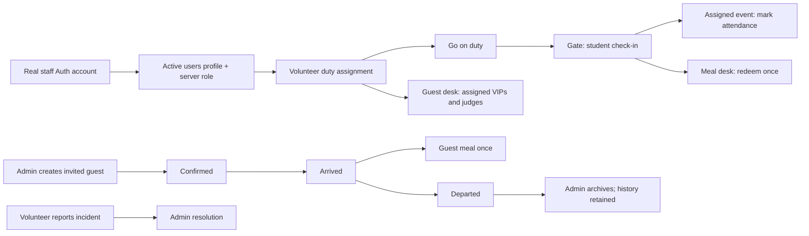

# CrossFire operations

Implemented for super admins, admins, and volunteers. Guest records are restricted to invited VIPs and judges. Admins manage volunteer and judge access; super admins also manage admin-level accounts and system settings.

## Screens and wireframes

Desktop uses a persistent operations sidebar and a workspace. Mobile uses a horizontal section navigator, stacked guest/duty cards, and stacked participant records. Public landing, event criteria, and student registration screens remain separate.

```text
SUPER ADMIN / ADMIN
┌──────────────────┬──────────────────────────────────────────────────┐
│ Overview         │ Event operations                         Refresh │
│ Student desk     ├──────────────────────────────────────────────────┤
│ VIP & judges     │ Title, role, connection/error feedback           │
│ Volunteer crew   │ Participant / arrival / guest / incident counts │
│ Event control    │ Arrival pipeline           Open incident queue  │
│ Incidents        │ Event schedule                                  │
│ Staff access     │                                                  │
│ Announcements    │ Section: search → record → explicit action      │
│ System settings* │ Forms: validation → save → server readback      │
│ Activity log     │                                                  │
└──────────────────┴──────────────────────────────────────────────────┘
* Super admin only

VOLUNTEER / MOBILE
┌────────────────────────────────────┐
│ Overview | My duty | Desk | Reports │
├────────────────────────────────────┤
│ Assigned station + shift + status  │
│ Go on duty / Start break           │
│ Pass lookup / Scan QR              │
│ Participant or assigned guest      │
│ The actions allowed at this desk   │
│ Incident report + resolution state │
└────────────────────────────────────┘
```

| Capability | Super admin | Admin | Volunteer |
|---|---|---|---|
| Participants, registration status, exports | All | All | Assigned duty only; no exports |
| Unverified registration request review | Yes, MFA required | Yes, MFA required | No |
| Gate check-in | Yes | Yes | On-duty gate station |
| Student meals | Yes | Yes | On-duty meal station |
| Event-room attendance | All events | All events | Assigned event only |
| Create/edit/confirm/archive VIP or judge | Yes | Yes | No |
| Guest arrival, meal, departure | All | All | Assigned guest or unassigned guest desk queue |
| Volunteer station, event, shift, kit, walkie | Yes | Yes | Own duty status only |
| Create/suspend/change volunteer and judge access | Yes | Yes | No |
| Manage admin/super-admin access | Yes, other accounts | No | No |
| System settings | Yes | No | No |
| Report incidents | Yes | Yes | Yes |
| Resolve incidents / activity log / announcements | Yes | Yes | No |

## Pipelines



Invited or confirmed guests can decline; an admin may invite a declined guest again. Guests cannot skip confirmation or re-enter after departure. Active guest assignments must be reassigned before suspending an escort or moving their station. Room reporting affects one registration, not all of a student's events. Check-in and room arrival are idempotent; duplicate meal issuance is rejected by a row-locked transaction.

## Data and authentication

- **Registration review** is a separate private queue for student submissions made without email verification. Admins and super admins can search, filter and page through requests, save an internal note, mark reviewed/declined or return a request to pending. Stale reviews are rejected; declined requests require a reason. All reviews are audited. These actions never create Auth users, confirm email addresses, reserve event places, issue passes or send messages.
- `crossfire_submit_registration_request` validates the entire input and event windows, bounds submissions per email/phone and globally, and returns only a receipt. Retrying the same request ID and unchanged details is idempotent. Requests are not visible to volunteers or judges and cannot be read directly through REST.
- Use **Refresh requests** to reload the review queue. Its pagination is server-side (25 records), and filtering never downloads the entire student intake into the browser.
- **Email & invitations** is available to admins and super admins. Configure the official sender, then separately invite reviewed students after the super admin opens the portal. Invitations create the approved account and entries, deliver a private password-setup link through the configured provider, and retain delivery status. Provider acceptance does not prove inbox delivery. The sender service is not configured yet; see [Student invitations](STUDENT_INVITATIONS.md) for setup and recovery.

- Live routes: `#admin` and `#volunteer`, both rendered by `src/operations/OperationsDashboard.tsx`.
- `crossfire_ops_snapshot()` returns the caller's permitted records. The screen refreshes after a successful write, on focus, and every 15 seconds while visible.
- `crossfire_ops_action(action, payload)` validates the active database role, duty station, assignment, and business state. RLS also restricts direct REST reads. Client role labels never authorize a write.
- Staff sign-in uses Supabase Auth email/password plus TOTP MFA and the authoritative `users` profile. Hardcoded email privileges, local staff sessions, metadata-derived roles, and plaintext volunteer login are removed from the active path.
- New staff accounts are created by `provision-staff`, using a server-only service credential. The caller's JWT is verified, role checked again in SQL, and a service-written Auth app-metadata marker prevents claiming another app's users in the shared project. Creation does not send email. Passwords are never stored in volunteer rows or returned in snapshots.
- Provisioning compensates only a newly created Auth account if profile creation definitely failed. An uncertain commit is read back before cleanup; an unverifiable commit is left for admin review.
- Guest/crew edit forms include the last update time to reject stale edits. Staff access changes also detect stale UI edits. A transaction advisory lock coordinates guest assignments with station/access edits.
- QR codes identify a pass; authenticated staff authority and current server state determine the action. They are not cryptographic identity proof.
- Announcements create in-app notifications. Notification polling works without Supabase Realtime publication setup; read status is persisted through RPCs. No SMS, WhatsApp, or email delivery is claimed.
- The active operations screens never substitute browser sample data for a failed live request.

## Verification and deployment

Run `npm run test:security` for disposable PGlite authorization/persistence tests and the actual Edge handler with mocked providers. These tests never connect to production or send messages. Public browser flows and anonymous live HTTP restrictions are checked separately. Multi-connection load, real camera hardware and a successful real-user Auth/MFA workflow still require acceptance testing.

There is no demo route or role switcher. To review staff screens, use an authorized real staff account and authenticator. The old fictional preview screenshots are not evidence of a production workflow.

See [SECURITY_RELEASE.md](SECURITY_RELEASE.md) for deployment status, release commands, email configuration and credential recovery. The connected project is shared: never reset it or rerun the historical base schema. Changes must be limited to CrossFire objects and the named Edge endpoints.

Staff password updates are available under **Account security** after authenticator verification. The creation password is not claimed to expire automatically. Lost authenticators require administrator identity verification and recovery through Supabase; the application cannot bypass MFA.

An invited judge's hospitality record and scoring login are separate records. Create the staff account and assign events when a guest also needs scoring access. Guest archive preserves history; a restore interface, shift-time enforcement and integrations for messages remain future work. Team-name/member fields are still deferred under `FUTURE_CHANGES.md`.
