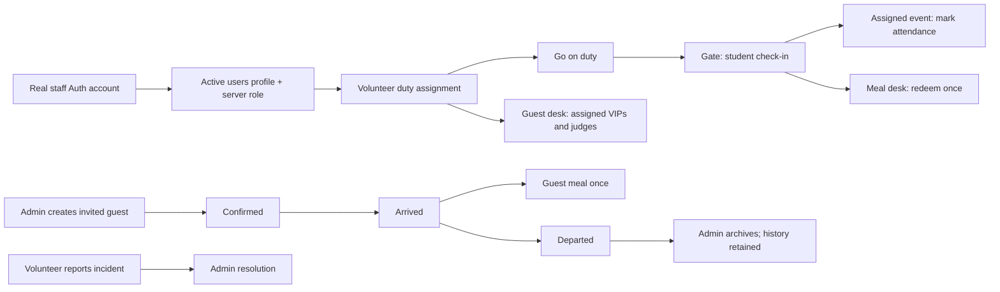

# CrossFire operations

Implemented for super admins, admins, and volunteers. Guest records are restricted to invited VIPs and judges. Admins manage volunteer and judge access; super admins also manage admin-level accounts and system settings.

## Screens and wireframes

Desktop uses a persistent operations sidebar and a workspace. Mobile uses a horizontal section navigator, stacked guest/duty cards, and stacked participant records. Public landing, event criteria, and student registration screens remain separate.

### Registered student directory

Admins and super admins open on **Student records**. This directory includes both student accounts and older submissions that do not yet have a login; the **Student desk** remains the operational check-in view for accounts with passes. Suspended accounts are labelled separately from available logins.

Search by name, student ID, reference, contact, institute, city or competition. Filter by registration/account/check-in state, sort by name or registration time, and open **View details** for all submitted fields, consent, attendance timestamps and the downloadable QR pass. Times are displayed in IST. The directory refreshes on live revisions, window focus and a 60-second fallback without clearing filters or the current page.

Excel and PDF exports can include **all records** or **matching records**, across every page. Export first reloads the data and stops if that read fails. Excel includes all 20 fields, styled headers, frozen headings, full-width filters and text-safe phone numbers. PDF uses a readable A4 registration sheet per student. Export modules load only when needed. Older submissions need a portal invitation before they have a login/pass; sending it remains an explicit admin action and requires the configured sender.

Verification: `npm run test:student-records`, `npm run test:accounts`, `npm run build`, and `npm run security:bundle`. Local browser checks cover search, pagination, detail dialogs, suspended-account filters, a 390px mobile layout, and failure-safe export. Test fixtures and rendered PDF previews stay in ignored `artifacts/` and are never included in the production build.

```text
SUPER ADMIN / ADMIN
┌──────────────────┬──────────────────────────────────────────────────┐
│ Overview         │ Event operations                         Refresh │
│ Student desk     ├──────────────────────────────────────────────────┤
│ VIP & judges     │ Title, role, connection/error feedback           │
│ Volunteer crew   │ Participant / arrival / guest / incident counts │
│ Event control    │ Arrival pipeline           Open incident queue  │
│ Incidents        │ Event schedule                                  │
│ Staff access     │                                                  │
│ Announcements    │ Section: search → record → explicit action      │
│ System settings* │ Forms: validation → save → server readback      │
│ Activity log     │                                                  │
└──────────────────┴──────────────────────────────────────────────────┘
* Super admin only

VOLUNTEER / MOBILE
┌────────────────────────────────────┐
│ Overview | My duty | Desk | Reports │
├────────────────────────────────────┤
│ Assigned station + shift + status  │
│ Go on duty / Start break           │
│ Pass lookup / Scan QR              │
│ Participant or assigned guest      │
│ The actions allowed at this desk   │
│ Incident report + resolution state │
└────────────────────────────────────┘
```

| Capability | Super admin | Admin | Volunteer | Judge | VIP guest | Student |
|---|---|---|---|---|---|---|
| Own profile and dashboard | Yes | Yes | Yes | Yes | Own invitation, guest pass, schedule | Own details, entries, QR pass |
| Student records, contact details, exports | All | All | No | No | No | Own only |
| Scan a student QR / look up a pass | Yes | Yes | On duty at gate, meal or own event room; minimal fields | No | No | No |
| Gate check-in / meal / room attendance | Yes | Yes | Own on-duty station / assigned event | No | No | No |
| Issue a new QR pass (revokes the old one) | Yes | Yes | No | No | No | No |
| Create/edit/confirm/archive VIP or judge guest records | Yes | Yes | No | No | No | No |
| Guest arrival, meal, departure | All | All | Assigned guest or unassigned guest desk queue | No | No | No |
| Volunteer station, event, shift, kit, walkie | Yes | Yes | Own duty status only | No | No | No |
| Create volunteer, judge and VIP guest logins; suspend them | Yes | Yes | No | No | No | No |
| Create/manage admin and super-admin logins | Yes, other accounts | No | No | No | No | No |
| Open/close student registration; other system settings | Yes | No | No | No | No | No |
| Report incidents | Yes | Yes | Yes (sees own reports) | No | No | No |
| Resolve incidents / activity log / announcements | Yes | Yes | No | No | No | No |
| Judging | All events (oversight) | All events (oversight) | No | Assigned events only; own scores | No | No |
| Register as a student | No | No | No | No | No | While registration is open |

Assumptions (least privilege where the brief was open): admins keep the existing activity log; VIP guests are read-only (no self-confirmation); invited judges use a judge login for scoring and cannot be given a VIP login; volunteers see a student's name, institute, meal preference, pass and entries, never email or phone.

## Pipelines



Invited or confirmed guests can decline; an admin may invite a declined guest again. Guests cannot skip confirmation or re-enter after departure. Active guest assignments must be reassigned before suspending an escort or moving their station. Room reporting affects one registration, not all of a student's events. Gate check-in, meal and room attendance each succeed once: the student or registration row is locked, a partial unique index on `crossfire_checkins` is the backstop, and a repeat scan returns "Already checked in". Admins can undo through the legacy endpoints; the ledger keeps the undone row.

## Data and authentication

- **Registration review** is a separate private queue for student submissions made without email verification. Admins and super admins can search, filter and page through requests, save an internal note, mark reviewed/declined or return a request to pending. Stale reviews are rejected; declined requests require a reason. All reviews are audited. These actions never create Auth users, confirm email addresses, reserve event places, issue passes or send messages.
- `crossfire_submit_registration_request` validates the entire input and event windows, bounds submissions per email/phone and globally, and returns only a receipt. Retrying the same request ID and unchanged details is idempotent. Requests are not visible to volunteers or judges and cannot be read directly through REST.
- Use **Refresh requests** to reload the review queue. Its pagination is server-side (25 records), and filtering never downloads the entire student intake into the browser.
- **Email & invitations** is available to admins and super admins. Configure the official sender, then separately invite reviewed students after the super admin opens the portal. Invitations create the approved account and entries, deliver a private password-setup link through the configured provider, and retain delivery status. Provider acceptance does not prove inbox delivery. The sender service is not configured yet; see [Student invitations](STUDENT_INVITATIONS.md) for setup and recovery.

- Live routes: `#admin` and `#volunteer`, both rendered by `src/operations/OperationsDashboard.tsx`.
- `crossfire_ops_snapshot()` returns the caller's permitted records. Gate/meal volunteers receive no student roster and use `crossfire_ops_lookup_pass(code)`, which validates the code format, the operator's duty and the pass state (unknown, replaced, suspended). The screen refreshes after a successful write, on focus, and every 15 seconds while visible.
- `crossfire_ops_action(action, payload)` validates the active database role, duty station, assignment, and business state. RLS also restricts direct REST reads. Client role labels never authorize a write.
- Staff sign-in uses Supabase Auth email/password (super admins add TOTP MFA) and the authoritative `users` profile. Provisioned accounts must replace their initial password: `current_user_role()` returns nothing until `crossfire_complete_password_change()` confirms Auth holds a different password hash. Only a SHA-256 digest of the initial hash is kept, and it is deleted after the change. Hardcoded email privileges, local staff sessions, metadata-derived roles, and plaintext volunteer login are removed from the active path.
- New staff accounts are created by `provision-staff`, using a server-only service credential. The caller's JWT is verified, role checked again in SQL, and a service-written Auth app-metadata marker prevents claiming another app's users in the shared project. Creation does not send email. Passwords are never stored in volunteer rows or returned in snapshots.
- Provisioning compensates only a newly created Auth account if profile creation definitely failed. An uncertain commit is read back before cleanup; an unverifiable commit is left for admin review.
- Guest/crew edit forms include the last update time to reject stale edits. Staff access changes also detect stale UI edits. A transaction advisory lock coordinates guest assignments with station/access edits.
- QR codes identify a pass; authenticated staff authority and current server state determine the action. They are not cryptographic identity proof.
- Announcements create in-app notifications. Notification polling works without Supabase Realtime publication setup; read status is persisted through RPCs. No SMS, WhatsApp, or email delivery is claimed.
- The active operations screens never substitute browser sample data for a failed live request.

## Verification and deployment

Run `npm run test:security` for disposable PGlite authorization/persistence tests and the actual Edge handler with mocked providers. These tests never connect to production or send messages. Public browser flows and anonymous live HTTP restrictions are checked separately. Multi-connection load, real camera hardware and a successful real-user Auth/MFA workflow still require acceptance testing.

There is no demo route or role switcher. To review staff screens, use an authorized real staff account and authenticator. The old fictional preview screenshots are not evidence of a production workflow.

See [SECURITY_RELEASE.md](SECURITY_RELEASE.md) for deployment status, release commands, email configuration and credential recovery. The connected project is shared: never reset it or rerun the historical base schema. Changes must be limited to CrossFire objects and the named Edge endpoints.

Staff password updates are available under **Account security** after authenticator verification. The creation password is not claimed to expire automatically. Lost authenticators require administrator identity verification and recovery through Supabase; the application cannot bypass MFA.

An invited judge's hospitality record and scoring login are separate records. Create the staff account and assign events when a guest also needs scoring access. Guest archive preserves history; a restore interface, shift-time enforcement and integrations for messages remain future work. Team-name/member fields are still deferred under `FUTURE_CHANGES.md`.

## Registration dashboard (reference design)

Admin and super admin Student records use the navy navigation and blue registration workspace. The five cards show all submissions, active student accounts, submissions without a login, QR passes created (including suspended accounts), and submissions today in Asia/Kolkata. Suspended passes are labelled in the table and rejected by the scanner.

Search combines with registration status, pass issuance, competition and course/board filters. The table supports 10/25/50 rows per page, stable sorting, and selection across pages and filters. Export Excel/PDF exports every matching row, not only the visible page. Bulk actions export selected IDs from a fresh authorized server response; an unavailable selected record or a failed refresh stops the export. Clear selection removes selections on every page. Full details include consent, dates, meal status and the downloadable QR pass. Older submissions remain clearly labelled without login and use the existing explicit invitation flow.

Verification for this redesign: `npm run test:student-records` covers combined filters, account status, IST midnight boundaries, and spreadsheet/PDF contents. Browser QA uses local fixtures outside the production build to exercise desktop/mobile layouts, selection across pages, filtered exports, details/QR and interrupted refreshes. Production permissions and registration/QR state transitions are covered separately by `npm run test:accounts`.
